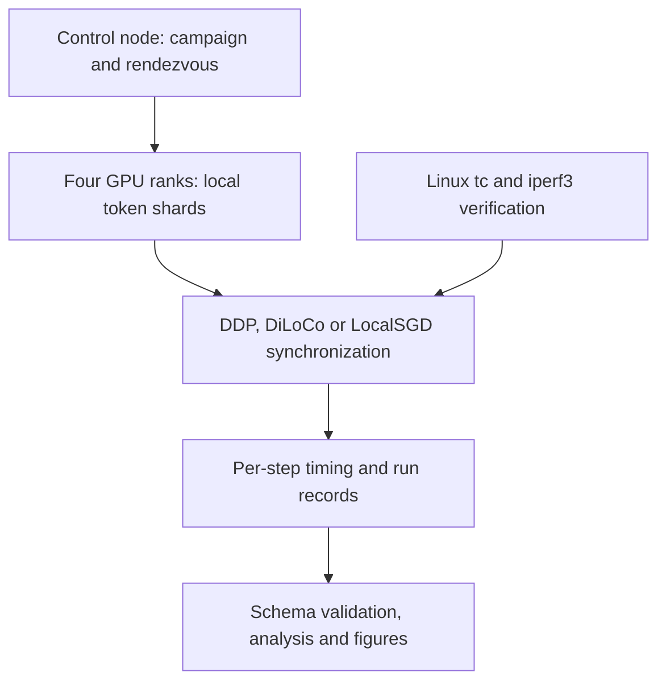

# Supported reproduction paths

## Offline analysis

From a clean clone with uv installed, run `make figures`, `uv run diloco-measured analyze`, and `make test`. Dependencies are installed from `uv.lock`; commands run in the project environment. Installation may require network access. The analysis reads committed records and requires no AWS credentials or GPU.

## Hardware measurement

The completed campaigns used the scripts below, not the unfinished unified CLI:

| Campaign | Entry point |
| --- | --- |
| DiLoCo bandwidth grid | `experiments/01_cu_grid/run_shaped_grid.py` |
| DDP and LocalSGD grids | `experiments/01_cu_grid/run_ddp_localsgd_grid.py` |
| DiLoCo convergence | `experiments/02_convergence/run_convergence_campaign.py` |
| Predictor fitting/validation | `experiments/05_predictor_validation/fit_and_validate_predictor.py` |

Read each campaign's NOTES.md and infrastructure preconditions before execution. Hardware runs require a separately approved compute budget. This maintenance change launches no cluster and reports no new measurements.

`run`, `grid`, `converge`, `plan`, and `network characterize` in the unified CLI are unsupported. They reject the request with exit code 2 before touching infrastructure. Their Make wrappers are compatibility errors, not working campaign launchers. `measurement/train.py` remains incomplete. Consolidating the runner, restart/fault experiments, and observed wire-byte accounting are future extension work and require hardware validation before use.

## Experimental topology

Read utilization and convergence together: the reported DiLoCo convergence campaign did not reach its reference loss within its fixed token budget. Utilization ratios are not quality or time-to-target speedups. DDP/LocalSGD utilization points have one repeat; DiLoCo shaped-grid points have three. No FSDP2 hardware result exists.

## CPU distributed CI

The separate `cpu-distributed` job installs CPU Torch 2.13.0 (the version in
`uv.lock`) and runs `requires_torch` unit and integration tests, including
multi-process Gloo collectives. This verifies reference algorithms and wiring;
it is not a GPU throughput benchmark or a hardware validation of FSDP2.
